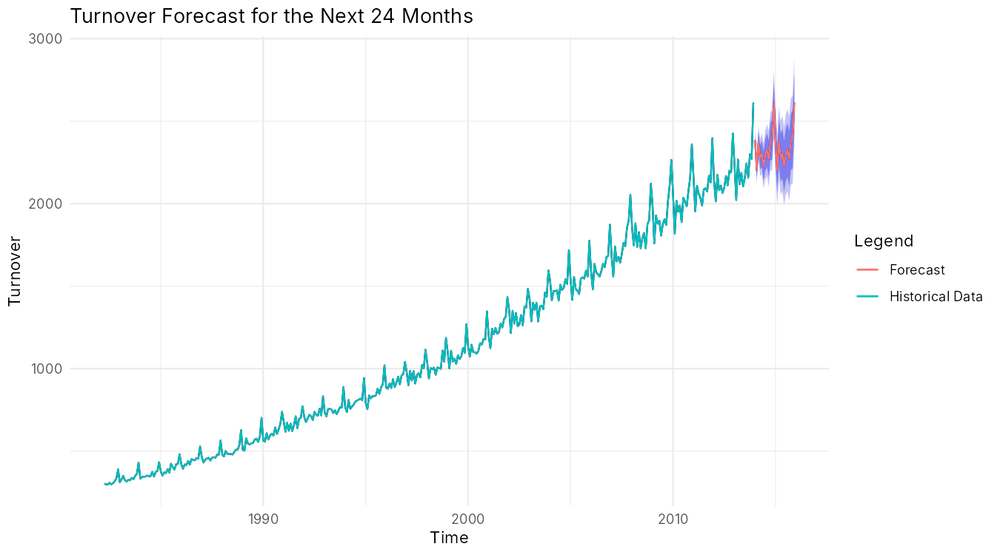

# Turnover forecasting: NSW supermarket and grocery stores

Monthly retail turnover forecasting in R, using five methods (naive, seasonal naive,
simple exponential smoothing, double exponential smoothing, STL decomposition).
The methods are compared on a test set and with time-series cross-validation,
checked with residual tests, and the best one produces a 24-month forecast.

## Data

| | |
|---|---|
| Series | `A3349335T`: Turnover; New South Wales; Supermarket and grocery stores |
| Source | Australian Bureau of Statistics (ABS), *Retail Trade, Australia*, Table 11 (retail turnover, state by industry subgroup, original) |
| File | `data/Turnover_Australia.xlsx` (sheet `Data1`, 189 series, monthly, April 1982 to December 2013) |

The Excel file is a trimmed extract of the ABS table: row 1 holds the series
descriptions, row 2 the Series IDs, and the data starts in row 3.
The latest full ABS table can be downloaded from the
[ABS Retail Trade page](https://www.abs.gov.au/statistics/industry/retail-and-wholesale-trade/retail-trade-australia/latest-release).
ABS data is published under a Creative Commons licence; please keep the attribution
(see the [ABS copyright page](https://www.abs.gov.au/website-privacy-copyright-and-disclaimer#copyright-and-creative-commons)).

## How to run

1. Install R and these packages:
   ```r
   install.packages(c("readxl", "forecast", "ggplot2"))
   ```
2. Get the project: clone the repository or download it as a ZIP and unzip it.
3. Run it:
   - **RStudio:** open `turnover-forecasting.Rproj`, open `run_all.R` and click **Source**.
   - **Terminal:** `Rscript run_all.R`

All paths are relative to the project folder, so no `setwd()` is needed.
The cross-validation step takes about a minute.

## Settings

Edit `R/00_config.R`:

| Setting | Meaning | Default |
|---|---|---|
| `id` | Series ID (a column name in the Excel file) | `"A3349335T"` |
| `train_ratio` | Share of data used for training | `0.7` |
| `boxcox_transform` | Use a Box-Cox transformation | `TRUE` |
| `lambda_user` | `NA` = choose lambda automatically, or a number | `NA` |
| `error_measure` | `"RMSE"`, `"MAPE"` or `"BOTH"` | `"BOTH"` |

## Project structure

```
turnover-forecasting/
├── run_all.R                 runs everything in order
├── turnover-forecasting.Rproj
├── data/
│   └── Turnover_Australia.xlsx
├── R/
│   ├── 00_config.R           settings and packages
│   ├── 01_load_data.R        read data, time series, train/test split
│   ├── 02_models.R           Box-Cox and the five forecasting methods
│   ├── 03_evaluation.R       test-set accuracy and cross-validation (RMSE, MAPE)
│   ├── 04_residuals.R        residual tests and plots
│   └── 05_forecast.R         24-month forecast with the chosen method
└── outputs/                  results created by the run
```

## Results (default settings)

Cross-validation errors (forecast horizons 1 to 12):

| Method | RMSE | MAPE (%) |
|---|---|---|
| Naive | 100.15 | 6.68 |
| Seasonal naive | 73.14 | 6.35 |
| Simple exponential smoothing | 88.58 | 5.97 |
| Double exponential smoothing | 71.52 | 4.74 |
| **Decomposition (STL + naive)** | **35.32** | **2.56** |

The decomposition method has the lowest error, so it is used for the final forecast.
The Box-Cox lambda chosen automatically from the training data is about 0.246.



Files in `outputs/`: `forecast_24_months.csv`, `forecast_24_months.png`,
`cv_errors.csv`, `residual_tests.csv`, and `all_plots.pdf` (every plot of the run).
